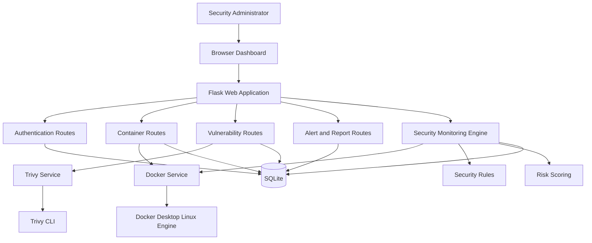

# Container Security Monitoring Framework for Docker-Based Applications

## Phase 1 design baseline

This document defines the first implementation baseline for the academic B.Tech project. The prototype is intended for a local, controlled Docker Desktop environment and will be implemented with Flask, Docker SDK for Python, Trivy, SQLite, HTML/CSS/JavaScript, and Chart.js.

## 1. Project objective

Provide a web dashboard for a Security Administrator to inspect Docker containers, identify security misconfigurations, monitor runtime usage, scan images for known vulnerabilities, calculate a project-defined security score, manage alerts, and generate security reports.

The system is a monitoring and assessment tool. It does not automatically modify, stop, or delete containers in the MVP.

## 2. Actors and responsibilities

### Security Administrator

- Authenticate using the web dashboard.
- View container and image inventory.
- Inspect container configuration, processes, logs, and resource usage.
- Run image vulnerability scans.
- Review CVEs, security findings, scores, alerts, and recommendations.
- Mark alerts as resolved.
- Export a security report.

### Docker Engine

- Provides container, image, network, mount, process, log, port, and resource data.
- Runs through Docker Desktop's Linux engine using the local Docker connection.

### Security Monitoring Engine

- Collects Docker data.
- Applies deterministic security rules.
- Calculates security scores.
- Creates and updates alerts.

### Trivy

- Scans Docker images.
- Returns vulnerability results in JSON format.

## 3. Functional requirements

| ID | Requirement | Priority |
|---|---|---|
| FR-01 | Administrator can log in and log out. | Must |
| FR-02 | Administrator can view all containers, including running and stopped containers. | Must |
| FR-03 | Administrator can view container status, image, ports, networks, mounts, and creation time. | Must |
| FR-04 | Administrator can view CPU, memory, network, and block I/O statistics for running containers. | Must |
| FR-05 | Administrator can view recent container logs and running processes. | Must |
| FR-06 | System can inspect container security configuration. | Must |
| FR-07 | System can calculate a security score between 0 and 100. | Must |
| FR-08 | Administrator can scan a Docker image with Trivy. | Must |
| FR-09 | Administrator can view CVE ID, package, severity, versions, and description. | Must |
| FR-10 | System can create alerts from security findings and critical vulnerabilities. | Must |
| FR-11 | Administrator can mark an alert as resolved. | Must |
| FR-12 | Administrator can export a security report. | Should |
| FR-13 | Background monitoring can refresh container data periodically. | Should |

## 4. Non-functional requirements

- The application should run locally at `http://127.0.0.1:5000`.
- The application should work with Docker Desktop's Linux containers.
- The MVP should support at least 10 local containers without requiring external services.
- Passwords must be stored as hashes, never as plaintext.
- Flask routes requiring administrator data must require authentication.
- Docker and Trivy failures must produce readable error messages instead of crashing the dashboard.
- SQLite is sufficient for the academic prototype.
- Security findings and vulnerability results must include a scan or detection timestamp.
- The application must not automatically change container state in the MVP.

## 5. System architecture



### Responsibility boundaries

- Routes handle HTTP requests, authorization, validation, and responses.
- Services communicate with Docker and Trivy.
- The security engine contains rules and scoring logic, independent of HTML templates.
- Database models represent stored results and history.
- Templates and JavaScript display data but do not directly access Docker.

## 6. Proposed project structure

```text
container-security-monitor/
├── app.py
├── config.py
├── requirements.txt
├── instance/
│   └── security_monitor.db
├── app/
│   ├── __init__.py
│   ├── extensions.py
│   ├── models/
│   ├── routes/
│   ├── services/
│   ├── security/
│   ├── templates/
│   └── static/
├── tests/
├── docs/
└── README.md
```

Planned service modules:

```text
docker_service.py       Docker SDK operations
trivy_service.py        Trivy execution and JSON parsing
monitoring_service.py   Periodic collection workflow
security_engine.py      Rule evaluation
scoring_service.py      Security score calculation
report_service.py       HTML/CSV report generation
```

## 7. Database design

### users

```text
id              INTEGER PRIMARY KEY
username        TEXT UNIQUE NOT NULL
password_hash   TEXT NOT NULL
created_at      DATETIME NOT NULL
```

### containers

Stores the latest known container inventory record.

```text
id              INTEGER PRIMARY KEY
docker_id       TEXT UNIQUE NOT NULL
name            TEXT NOT NULL
image           TEXT
status          TEXT
created_at      DATETIME
last_seen_at    DATETIME NOT NULL
```

### container_metrics

Stores periodic runtime snapshots.

```text
id              INTEGER PRIMARY KEY
container_id    INTEGER NOT NULL REFERENCES containers(id)
cpu_percent     REAL
memory_usage    INTEGER
memory_limit    INTEGER
network_rx      INTEGER
network_tx      INTEGER
block_read      INTEGER
block_write     INTEGER
captured_at     DATETIME NOT NULL
```

### security_checks

Stores rule results for a container inspection.

```text
id              INTEGER PRIMARY KEY
container_id    INTEGER NOT NULL REFERENCES containers(id)
rule_code       TEXT NOT NULL
rule_name       TEXT NOT NULL
status          TEXT NOT NULL
severity        TEXT NOT NULL
description     TEXT NOT NULL
recommendation  TEXT NOT NULL
detected_at     DATETIME NOT NULL
```

### image_scans

```text
id              INTEGER PRIMARY KEY
image_name      TEXT NOT NULL
scan_status     TEXT NOT NULL
scanner         TEXT NOT NULL
scanned_at      DATETIME NOT NULL
```

### vulnerabilities

```text
id              INTEGER PRIMARY KEY
image_scan_id   INTEGER NOT NULL REFERENCES image_scans(id)
cve_id          TEXT
package_name    TEXT
installed_ver   TEXT
fixed_ver       TEXT
severity        TEXT NOT NULL
title           TEXT
description     TEXT
```

### alerts

```text
id              INTEGER PRIMARY KEY
container_id    INTEGER REFERENCES containers(id)
image_scan_id   INTEGER REFERENCES image_scans(id)
alert_type      TEXT NOT NULL
severity        TEXT NOT NULL
message         TEXT NOT NULL
recommendation  TEXT NOT NULL
status          TEXT NOT NULL
created_at      DATETIME NOT NULL
resolved_at     DATETIME
```

## 8. Security rules for the MVP

| Code | Rule | Severity | Score deduction |
|---|---|---:|---:|
| CFG-001 | Container runs as root | High | 20 |
| CFG-002 | Privileged mode enabled | Critical | 30 |
| CFG-003 | Host network mode enabled | High | 20 |
| CFG-004 | Host PID mode enabled | High | 20 |
| CFG-005 | Docker socket mounted | Critical | 30 |
| CFG-006 | Sensitive host path mounted | Critical | 30 |
| CFG-007 | Dangerous capability enabled | High | 20 |
| CFG-008 | Public or unnecessary port exposed | Medium | 10 |
| CFG-009 | CPU or memory limits missing | Medium | 10 |
| CFG-010 | Image uses the `latest` tag | Low | 5 |

The engine should avoid repeatedly creating identical open alerts on every monitoring cycle. It should reuse an existing open alert for the same container and rule, and create a new alert only after the issue is resolved and detected again.

## 9. Risk-scoring model

Every container starts with a score of 100.

```text
score = 100 - sum(deductions for failed checks)
score = max(0, min(100, score))
```

Risk categories:

```text
90–100  Secure
70–89   Moderate
40–69   Risky
0–39    Critical
```

The score is an educational, project-defined indicator. It is not presented as an official Docker or CVSS score.

For image vulnerabilities, the dashboard will show severity counts separately. This prevents combining configuration risk and CVSS data into a misleading single industry-standard number.

## 10. Initial API plan

### Authentication

```text
GET  /login
POST /login
POST /logout
```

### Dashboard

```text
GET /dashboard
GET /api/dashboard/summary
```

### Containers

```text
GET /containers
GET /containers/<docker_id>
GET /api/containers
GET /api/containers/<docker_id>/stats
GET /api/containers/<docker_id>/logs
GET /api/containers/<docker_id>/processes
GET /api/containers/<docker_id>/security
```

### Vulnerabilities

```text
POST /api/images/<image_name>/scan
GET  /vulnerabilities
GET  /api/scans/<scan_id>
```

### Alerts and reports

```text
GET  /alerts
POST /alerts/<alert_id>/resolve
GET  /reports/security
GET  /reports/security.csv
```

## 11. Main dashboard pages

1. **Login** — username and password.
2. **Overview** — total containers, running containers, vulnerability counts, open alerts, and score summary.
3. **Containers** — searchable table of all containers.
4. **Container details** — configuration, score, findings, ports, mounts, logs, and processes.
5. **Runtime monitor** — CPU, memory, network, and block I/O charts.
6. **Vulnerabilities** — image scans, CVEs, severity filters, and fixed versions.
7. **Alerts** — open/resolved alerts and recommendations.
8. **Reports** — report preview and export actions.

## 12. Demonstration scenario

The final demonstration will use two containers: one normal container and one intentionally unsafe test container.

```bash
docker run -d --name normal-nginx -p 8081:80 nginx:latest

docker run -d \
  --name unsafe-nginx \
  --privileged \
  --network host \
  -v /var/run/docker.sock:/var/run/docker.sock \
  nginx:latest
```

Expected system behavior:

1. The dashboard discovers both containers.
2. `normal-nginx` receives few or no configuration findings.
3. `unsafe-nginx` is flagged for privileged mode, host networking, and Docker socket mounting.
4. The unsafe container receives a low security score.
5. Critical alerts are created with recommendations.
6. The administrator scans `nginx:latest` with Trivy.
7. CVEs are displayed by severity.
8. The administrator reviews the findings and exports a report.

The unsafe container is for a controlled local demonstration only and must not be used for production workloads.

## 13. Phase 1 acceptance criteria

Phase 1 is complete when:

- The scope and actor responsibilities are documented.
- The architecture and module boundaries are defined.
- The database entities and relationships are defined.
- The security rules and scoring model are documented.
- The initial API and page list is agreed.
- A repeatable demonstration scenario exists.
- The MVP and optional features are clearly separated.

## 14. Deferred features

These are intentionally excluded from the first implementation cycle:

- Kubernetes support
- Machine-learning anomaly detection
- Email or SMS notification
- Automatic remediation
- Multi-tenant deployment
- Prometheus/Grafana integration
- PDF generation unless time permits
- Advanced role-based access control
